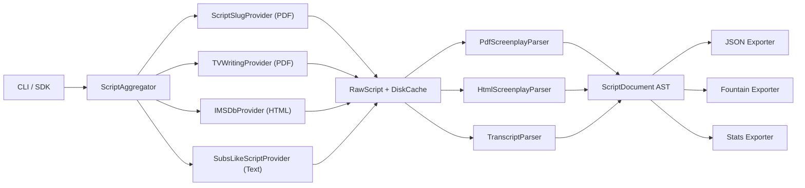

# rtfs

[](https://github.com/AtaCanYmc/rtfs/actions/workflows/ci.yml)
[](https://www.python.org/downloads/)
[](LICENSE)

`rtfs` is an asynchronous Python 3.11+ CLI and SDK that queries multiple screenplay archives, parses PDF and HTML layouts into a typed Pydantic v2 Abstract Syntax Tree, and exports to JSON, Fountain, or dialogue analytics.

## Table of Contents

- [Quick Start](#quick-start)
- [Architecture](#architecture)
- [Repository Layout](#repository-layout)
- [CLI Reference](#cli-reference)
- [Python SDK](#python-sdk)
- [FAQ](#faq)
- [Development & Verification](#development--verification)
- [License](#license)

## Quick Start

Install the package and verify the CLI entry point:

```bash
uv pip install -e ".[dev]"
rtfs --help
```

Search across configured screenplay providers:

```bash
rtfs search "The Matrix"
```

Fetch, parse, and export a screenplay to Fountain or JSON:

```bash
rtfs get "The Matrix" --format fountain --output matrix.fountain
rtfs get "The Matrix" --format json --output matrix.json
```

Compute scene and character dialogue metrics:

```bash
rtfs stats "The Matrix"
```

## Architecture

`rtfs` separates upstream HTTP retrieval from structural parsing. Every provider returns a `RawScript` payload containing raw bytes or strings alongside `ScriptMetadata`. Specialized parsers transform `RawScript` into a canonical `ScriptDocument` AST before handing it to exporters.



### Parsing Mechanics

1. **PDF Coordinate Clustering (`PdfScreenplayParser`)**: Extracts text spans and bounding boxes via PyMuPDF `page.get_text("dict")`. Strips headers above `y0 < 50`, footers below `y1 > 740`, page numbers, revision stamps, and continuation markers. Groups horizontal `x0` offsets within an 8pt tolerance to classify action margins, dialogue columns, parentheticals, character cues, and right-aligned transitions. Consecutive lines in the same column merge when vertical delta is under `1.5x` line height.
2. **HTML Indentation & Tag Parsing (`HtmlScreenplayParser`)**: Extracts `<td class="scrtext"><pre>` blocks from IMSDb documents. Handles both `<b>`-delimited character cues and whitespace-indented scripts through 1D margin clustering.
3. **Transcript Normalization (`TranscriptParser`)**: Parses `SPEAKER: line` patterns and bracketed stage directions from HTML or plain-text transcripts into `ScriptDocument` scenes.

## Repository Layout

```text
rtfs/
├── .editorconfig
├── .gitattributes
├── .gitignore
├── .markdownlint.json
├── CONTRIBUTING.md
├── LICENSE
├── README.md
├── ROADMAP.md
├── SECURITY.md
├── pyproject.toml
├── src/
│   └── rtfs/
│       ├── __init__.py
│       ├── cli/
│       │   └── main.py
│       ├── core/
│       │   ├── aggregator.py
│       │   ├── cache.py
│       │   ├── http.py
│       │   └── models.py
│       ├── exporters/
│       │   ├── fountain_exp.py
│       │   ├── json_exp.py
│       │   └── stats_exp.py
│       ├── parsers/
│       │   ├── base.py
│       │   ├── html_screenplay.py
│       │   ├── pdf_screenplay.py
│       │   └── transcript.py
│       └── providers/
│           ├── base.py
│           ├── imsdb.py
│           ├── scriptslug.py
│           ├── subslikescript.py
│           └── tvwriting.py
└── tests/
    ├── fixtures/
    │   └── sample_imsdb.html
    ├── test_aggregator.py
    ├── test_exporters.py
    └── test_parsers.py
```

## CLI Reference

| Command | Argument / Flag | Default | Description |
| :--- | :--- | :--- | :--- |
| `rtfs search` | `<query>` | Required | Title query string to match across providers. |
| `rtfs search` | `--source`, `-s` | `all` | Filter by provider: `all`, `imsdb`, `scriptslug`, `tvwriting`, `subslikescript`. |
| `rtfs search` | `--allow-transcript` | `False` | Include fallback subtitle transcripts from `subslikescript`. |
| `rtfs get` | `<query_or_url>` | Required | Title query string or direct script URL. |
| `rtfs get` | `--format`, `-f` | `fountain` | Output format: `json`, `fountain`, `txt`. |
| `rtfs get` | `--output`, `-o` | `None` | Destination file path. Writes to `stdout` when omitted. |
| `rtfs get` | `--source`, `-s` | `all` | Restrict search to a single provider. |
| `rtfs get` | `--allow-transcript` | `False` | Fall back to transcript sources when screenplay sources miss. |
| `rtfs stats` | `<query_or_url>` | Required | Title query string or direct script URL to analyze. |
| `rtfs stats` | `--source`, `-s` | `all` | Restrict search to a single provider. |
| `rtfs stats` | `--allow-transcript` | `False` | Allow transcript sources for statistics calculation. |

## Python SDK

```python
import asyncio
from rtfs import ScriptAggregator, compute_stats, export_fountain, export_json


async def main() -> None:
    async with ScriptAggregator() as agg:
        results = await agg.search("The Matrix", allow_transcript=False)
        for item in results[:3]:
            print(f"{item.title} [{item.source}] score={item.score}")

        doc = await agg.get("The Matrix")
        fountain_text = export_fountain(doc)
        json_payload = export_json(doc)

        stats = compute_stats(doc)
        print(f"Scenes: {stats.total_scenes} | INT/EXT: {stats.int_ext_ratio}")
        for char in stats.top_characters[:5]:
            print(f"{char.character}: {char.dialogue_turns} turns, {char.word_count} words")


asyncio.run(main())
```

## FAQ

### Why are transcripts excluded by default?

Subtitle transcripts lack scene headings, action paragraphs, parentheticals, and character modifiers. `rtfs` prioritizes shooting scripts and production drafts from `scriptslug`, `tvwriting`, and `imsdb`. Pass `--allow-transcript` or `allow_transcript=True` when a transcript is acceptable.

### Where are downloaded PDFs and HTML pages cached?

`ScriptCache` stores responses in a SQLite-backed directory at `~/.cache/rtfs` with a default TTL of 7 days. To clear the cache programmatically, call `ScriptCache().clear()`.

### Why is `rtfs` licensed under AGPL-3.0-or-later?

`rtfs` depends directly on PyMuPDF (`pymupdf`) for coordinate-based PDF extraction. PyMuPDF is distributed under the GNU Affero General Public License v3.0. Licensing `rtfs` under `AGPL-3.0-or-later` maintains full legal compliance with upstream copyleft terms.

## Development & Verification

Run the linter and unit test suite:

```bash
.venv/bin/ruff check .
.venv/bin/pytest -v
```

## License

Copyright (c) 2026 AtaCanYmc. Distributed under the [GNU Affero General Public License v3.0 or later](LICENSE).
