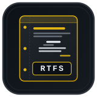
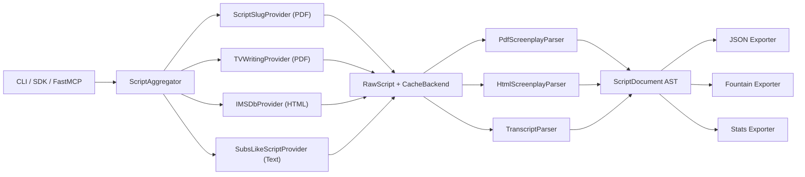

<div align="center">
  
  <h1>rtfs</h1>
  <p><strong>Read The F***ing Script — Multi-Source Screenplay CLI, Python SDK &amp; FastMCP Server</strong></p>

[](https://github.com/AtaCanYmc/rtfs/actions/workflows/ci.yml)
[](https://pypi.org/project/pyrtfs/)
[](https://github.com/AtaCanYmc/homebrew-tap/blob/main/Formula/rtfs.rb)
[](https://www.python.org/downloads/)
[](LICENSE)
</div>

`rtfs` is an asynchronous Python 3.11+ CLI, SDK, and FastMCP server that queries multiple screenplay archives, parses PDF and HTML layouts into a typed Pydantic v2 Abstract Syntax Tree, and exports to JSON, Fountain, or dialogue analytics.

## Table of Contents

- [Quick Start](#quick-start)
- [Architecture](#architecture)
- [MCP Server](#mcp-server)
- [Caching](#caching)
- [Repository Layout](#repository-layout)
- [CLI Reference](#cli-reference)
- [Python SDK](#python-sdk)
- [FAQ](#faq)
- [Development & Verification](#development--verification)
- [License](#license)

## Quick Start

Install via Homebrew or `pip` / `uv`:

```bash
# Homebrew (macOS & Linux)
brew install AtaCanYmc/tap/rtfs

# PyPI
pip install "pyrtfs[all]"

# Local editable install
uv pip install -e ".[dev]"
rtfs --help
```

Search across configured screenplay providers:

```bash
rtfs search "The Matrix"
```

Fetch, parse, and export a screenplay to Fountain or JSON:

```bash
rtfs get "The Matrix" --format fountain --output matrix.fountain
rtfs get "The Matrix" --format json --output matrix.json
```

Compute scene and character dialogue metrics:

```bash
rtfs stats "The Matrix"
```

## Architecture

`rtfs` separates upstream HTTP retrieval from structural parsing. Every provider returns a `RawScript` payload containing raw bytes or strings alongside `ScriptMetadata`. Specialized parsers transform `RawScript` into a canonical `ScriptDocument` AST before handing it to exporters or the progressive-disclosure MCP layer.



### Parsing Mechanics

1. **PDF Coordinate Clustering (`PdfScreenplayParser`)**: Extracts text spans and bounding boxes via PyMuPDF `page.get_text("dict")`. Strips headers above `y0 < 50`, footers below `y1 > 740`, page numbers, revision stamps, and continuation markers. Groups horizontal `x0` offsets within an 8pt tolerance to classify action margins, dialogue columns, parentheticals, character cues, and right-aligned transitions. Consecutive lines in the same column merge when vertical delta is under `1.5x` line height.
2. **HTML Indentation & Tag Parsing (`HtmlScreenplayParser`)**: Extracts `<td class="scrtext"><pre>` blocks from IMSDb documents. Handles both `<b>`-delimited character cues and whitespace-indented scripts through 1D margin clustering.
3. **Transcript Normalization (`TranscriptParser`)**: Parses `SPEAKER: line` patterns and bracketed stage directions from HTML or plain-text transcripts into `ScriptDocument` scenes.

## MCP Server

Full feature-length screenplays typically span 25,000 to 35,000 tokens. The `rtfs` Model Context Protocol (MCP) server exposes progressive-disclosure tools so AI agents can search titles, inspect the scene heading index, fetch bounded scene ranges (max 10 scenes per call), or filter dialogue by character and keyword without exhausting their context window.

### Installation

```bash
pip install "pyrtfs[mcp]"
# or install all optional extras (Redis + MCP)
pip install "pyrtfs[all]"
```

### Exposed MCP Tools & Resources

| Tool / Resource | Parameters | Description |
| :--- | :--- | :--- |
| `search_scripts` | `query`, `allow_transcript=False`, `limit=10` | Searches across active providers and returns concise metadata records. |
| `get_script_overview` | `query_or_url`, `source=None` | Returns metadata, total scene count, top 15 speaking characters, and a full `scene_index` (`scene_number`, `heading`) without dumping body text. |
| `get_scenes` | `query_or_url`, `start_scene`, `end_scene=None`, `format="fountain"` | Returns a single scene or inclusive range (hard-capped at 10 scenes per call) in Fountain or JSON format. |
| `search_dialogue` | `query_or_url`, `character=None`, `keyword=None`, `limit=30` | Case-insensitive filtering of dialogue turns by character name and/or keyword. |
| `get_script_stats` | `query_or_url` | Returns scene counts, `INT.` vs. `EXT.` breakdown, dialogue-to-action ratio, and character distribution. |
| `rtfs://script/{source}/{slug}/fountain` | `source`, `slug` | MCP resource returning the complete Fountain screenplay when a client explicitly attaches it. |

### Client Configuration (`claude_desktop_config.json` / Cursor)

```json
{
  "mcpServers": {
    "rtfs": {
      "command": "uvx",
      "args": ["--from", "pyrtfs[mcp]", "rtfs", "mcp"],
      "env": {
        "RTFS_CACHE_URL": "disk://~/.cache/rtfs"
      }
    }
  }
}
```

Or if installed directly into an environment:

```json
{
  "mcpServers": {
    "rtfs": {
      "command": "rtfs",
      "args": ["mcp", "--transport", "stdio"]
    }
  }
}
```

## Caching

`rtfs` uses a pluggable async `CacheBackend` protocol operating strictly on `bytes`. By default, responses cache locally on disk at `~/.cache/rtfs` using `DiskCacheBackend`.

### Supported Cache URIs

| URI Pattern | Backend Class | Description |
| :--- | :--- | :--- |
| `disk://~/.cache/rtfs` | `DiskCacheBackend` | Default SQLite-backed disk cache offloaded via `asyncio.to_thread`. |
| `redis://localhost:6379/0` | `RedisCacheBackend` | Async Redis cache (`rediss://` also supported). Requires `pip install pyrtfs[redis]`. |
| `memory://` | `MemoryCacheBackend` | Ephemeral in-memory dictionary with monotonic TTL expiration. |
| `none://` | `NullCacheBackend` | No-op cache backend (equivalent to `--no-cache`). |

### Configuring Cache via Environment or CLI

```bash
# Override via environment variable
export RTFS_CACHE_URL="redis://localhost:6379/0"
rtfs search "The Matrix"

# Override per command via --cache-url
rtfs get "The Matrix" --cache-url "disk:///tmp/rtfs-cache"

# Disable caching for a single invocation
rtfs stats "The Matrix" --no-cache
```

To use the Redis backend, install the optional `redis` extra:

```bash
pip install "pyrtfs[redis]"
```

## Repository Layout

```text
rtfs/
├── .editorconfig
├── .gitattributes
├── .gitignore
├── .markdownlint.json
├── .release-please-manifest.json
├── assets/
│   └── logo.svg
├── CHANGELOG.md
├── CONTRIBUTING.md
├── LICENSE
├── Makefile
├── README.md
├── release-please-config.json
├── ROADMAP.md
├── SECURITY.md
├── pyproject.toml
├── src/
│   └── rtfs/
│       ├── __init__.py
│       ├── cli/
│       │   └── main.py
│       ├── core/
│       │   ├── aggregator.py
│       │   ├── cache/
│       │   │   ├── __init__.py
│       │   │   ├── base.py
│       │   │   ├── disk.py
│       │   │   ├── factory.py
│       │   │   ├── memory.py
│       │   │   ├── null.py
│       │   │   └── redis.py
│       │   ├── http.py
│       │   └── models.py
│       ├── exporters/
│       │   ├── fountain_exp.py
│       │   ├── json_exp.py
│       │   └── stats_exp.py
│       ├── mcp/
│       │   ├── __init__.py
│       │   └── server.py
│       ├── parsers/
│       │   ├── base.py
│       │   ├── html_screenplay.py
│       │   ├── pdf_screenplay.py
│       │   └── transcript.py
│       └── providers/
│           ├── base.py
│           ├── imsdb.py
│           ├── scriptslug.py
│           ├── subslikescript.py
│           └── tvwriting.py
└── tests/
    ├── fixtures/
    │   └── sample_imsdb.html
    ├── test_aggregator.py
    ├── test_cache.py
    ├── test_exporters.py
    ├── test_mcp.py
    ├── test_parsers.py
    └── test_security.py
```

## CLI Reference

| Command | Argument / Flag | Default | Description |
| :--- | :--- | :--- | :--- |
| `rtfs search` | `<query>` | Required | Title query string to match across providers. |
| `rtfs search` | `--source`, `-s` | `all` | Filter by provider: `all`, `imsdb`, `scriptslug`, `tvwriting`, `subslikescript`. |
| `rtfs search` | `--allow-transcript` | `False` | Include fallback subtitle transcripts from `subslikescript`. |
| `rtfs search` | `--cache-url` | `None` | Cache backend URI (`disk://`, `redis://`, `memory://`, `none://`). Overrides `RTFS_CACHE_URL`. |
| `rtfs search` | `--no-cache` | `False` | Disable caching (`none://`). Takes precedence over `--cache-url`. |
| `rtfs get` | `<query_or_url>` | Required | Title query string or direct script URL. |
| `rtfs get` | `--format`, `-f` | `fountain` | Output format: `json`, `fountain`, `txt`. |
| `rtfs get` | `--output`, `-o` | `None` | Destination file path. Writes to `stdout` when omitted. |
| `rtfs get` | `--source`, `-s` | `all` | Restrict search to a single provider. |
| `rtfs get` | `--allow-transcript` | `False` | Fall back to transcript sources when screenplay sources miss. |
| `rtfs get` | `--cache-url` | `None` | Cache backend URI. Overrides `RTFS_CACHE_URL`. |
| `rtfs get` | `--no-cache` | `False` | Disable caching (`none://`). |
| `rtfs stats` | `<query_or_url>` | Required | Title query string or direct script URL to analyze. |
| `rtfs stats` | `--source`, `-s` | `all` | Restrict search to a single provider. |
| `rtfs stats` | `--allow-transcript` | `False` | Allow transcript sources for statistics calculation. |
| `rtfs stats` | `--cache-url` | `None` | Cache backend URI. Overrides `RTFS_CACHE_URL`. |
| `rtfs stats` | `--no-cache` | `False` | Disable caching (`none://`). |
| `rtfs mcp` | `--transport`, `-t` | `stdio` | MCP transport protocol: `stdio` or `sse`. |
| `rtfs mcp` | `--host` | `127.0.0.1` | Bind host when running SSE transport. |
| `rtfs mcp` | `--port` | `8000` | Bind port when running SSE transport. |
| `rtfs mcp` | `--cache-url` | `None` | Cache backend URI. Overrides `RTFS_CACHE_URL`. |
| `rtfs mcp` | `--no-cache` | `False` | Disable caching (`none://`). |

## Python SDK

```python
import asyncio
from rtfs import (
    MemoryCacheBackend,
    ScriptAggregator,
    compute_stats,
    export_fountain,
    export_json,
)


async def main() -> None:
    # Pass a CacheBackend instance, a URI string ("redis://localhost:6379/0"), or None
    cache = MemoryCacheBackend(default_ttl=3600)
    async with ScriptAggregator(cache=cache) as agg:
        results = await agg.search("The Matrix", allow_transcript=False)
        for item in results[:3]:
            print(f"{item.title} [{item.source}] score={item.score}")

        doc = await agg.get("The Matrix")
        fountain_text = export_fountain(doc)
        json_payload = export_json(doc)

        stats = compute_stats(doc)
        print(f"Scenes: {stats.total_scenes} | INT/EXT: {stats.int_ext_ratio}")
        for char in stats.top_characters[:5]:
            print(f"{char.character}: {char.dialogue_turns} turns, {char.word_count} words")


asyncio.run(main())
```

## FAQ

### Why are transcripts excluded by default?

Subtitle transcripts lack scene headings, action paragraphs, parentheticals, and character modifiers. `rtfs` prioritizes shooting scripts and production drafts from `scriptslug`, `tvwriting`, and `imsdb`. Pass `--allow-transcript` or `allow_transcript=True` when a transcript is acceptable.

### How do I implement a custom cache backend?

Implement the four async methods of `CacheBackend` (`get`, `set`, `delete`, `close`) operating on `bytes`, and pass your instance to `ScriptAggregator(cache=MyCustomCache())`. All Pydantic serialization uses JSON and base64 encoding at the provider boundary rather than `pickle`.

### Why is `rtfs` licensed under AGPL-3.0-or-later?

`rtfs` depends directly on PyMuPDF (`pymupdf`) for coordinate-based PDF extraction. PyMuPDF is distributed under the GNU Affero General Public License v3.0. Licensing `rtfs` under `AGPL-3.0-or-later` maintains full legal compliance with upstream copyleft terms.

## Development & Verification

Run the linter and unit test suite via `Makefile` or directly:

```bash
make help
make check
# or directly:
.venv/bin/ruff check .
.venv/bin/pytest -v
```

## License

Copyright (c) 2026 AtaCanYmc. Distributed under the [GNU Affero General Public License v3.0 or later](LICENSE).
