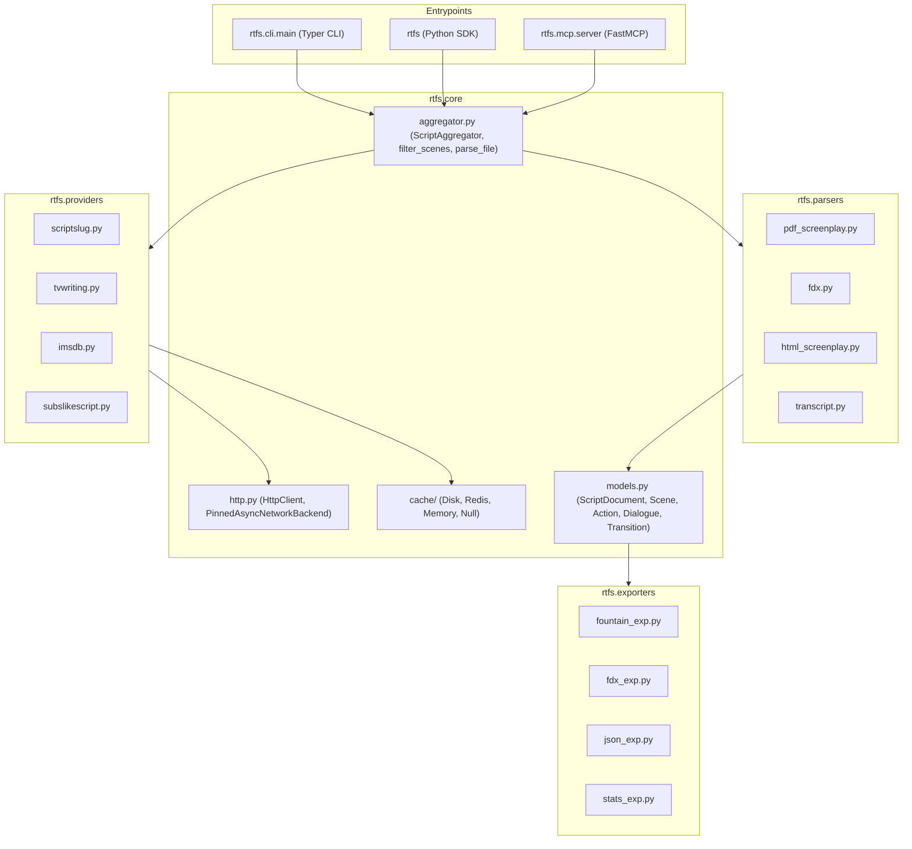

# rtfs Documentation & Module Examples

[← Back to Root Repository](../README.md)

This directory contains runnable examples and API reference guides for every module in `rtfs` (`pyrtfs`).

## Module Guides

| Guide | Covered Modules | Topics |
| :--- | :--- | :--- |
| [Core Models, HTTP, Cache & Aggregator](core.md) | `rtfs.core.models`, `rtfs.core.http`, `rtfs.core.cache`, `rtfs.core.aggregator` | Strict Pydantic v2 AST construction, DNS-pinned `HttpClient`, pluggable `CacheBackend` (`disk://`, `redis://`, `memory://`, `none://`), `ScriptAggregator`, `filter_scenes`, and `parse_file`. |
| [Providers](providers.md) | `rtfs.providers.base`, `rtfs.providers.imsdb`, `rtfs.providers.scriptslug`, `rtfs.providers.tvwriting`, `rtfs.providers.subslikescript` | Direct provider usage, domain allowlists (`resolve_allowed_url`), stopword-safe fuzzy ranking (`compute_title_similarity`), and writing a custom provider. |
| [Parsers](parsers.md) | `rtfs.parsers.base`, `rtfs.parsers.pdf_screenplay`, `rtfs.parsers.html_screenplay`, `rtfs.parsers.transcript`, `rtfs.parsers.fdx` | Coordinate-clustered PDF parsing with dual-column simultaneous dialogue, IMSDb HTML `<pre>` parsing, plain-text transcript normalization, and XXE-hardened Final Draft (`.fdx`) XML parsing. |
| [Exporters & Analytics](exporters.md) | `rtfs.exporters.fountain_exp`, `rtfs.exporters.json_exp`, `rtfs.exporters.fdx_exp`, `rtfs.exporters.stats_exp` | Exporting `ScriptDocument` to Fountain (`^` dual dialogue), formatted JSON, Final Draft `.fdx` XML (`<DualDialogue>`), and computing scene/character analytics (`compute_stats`). |
| [CLI & FastMCP Server](cli-and-mcp.md) | `rtfs.cli.main`, `rtfs.mcp.server` | Interactive CLI selection, scene filtering, offline local file parsing, concurrent batch export, cache management, and progressive-disclosure FastMCP tools (`MCPService`). |

## Architecture Overview

